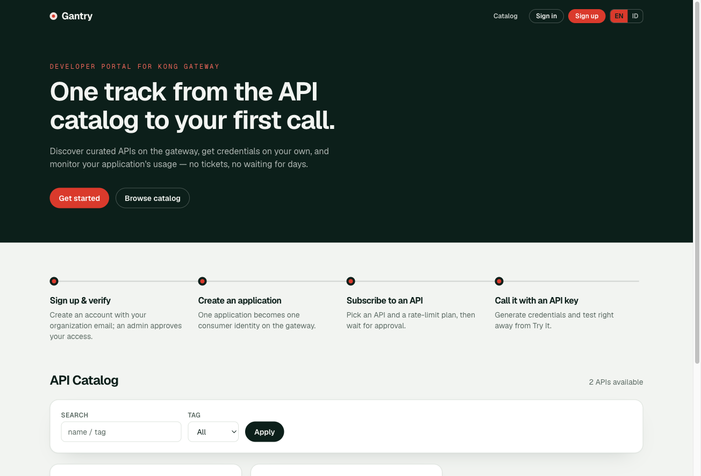
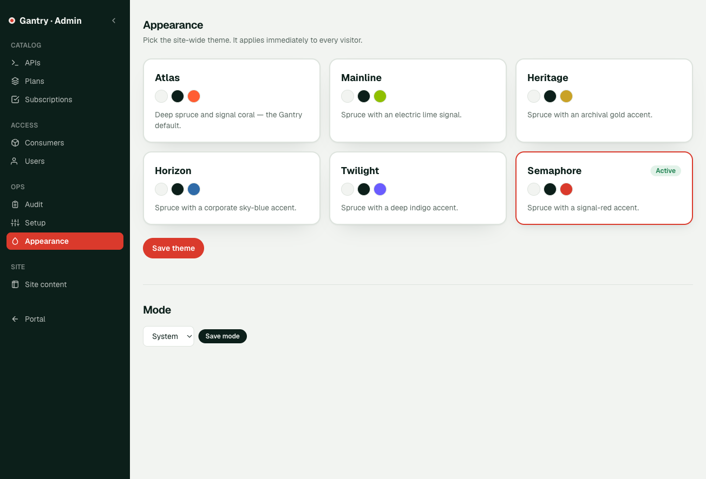
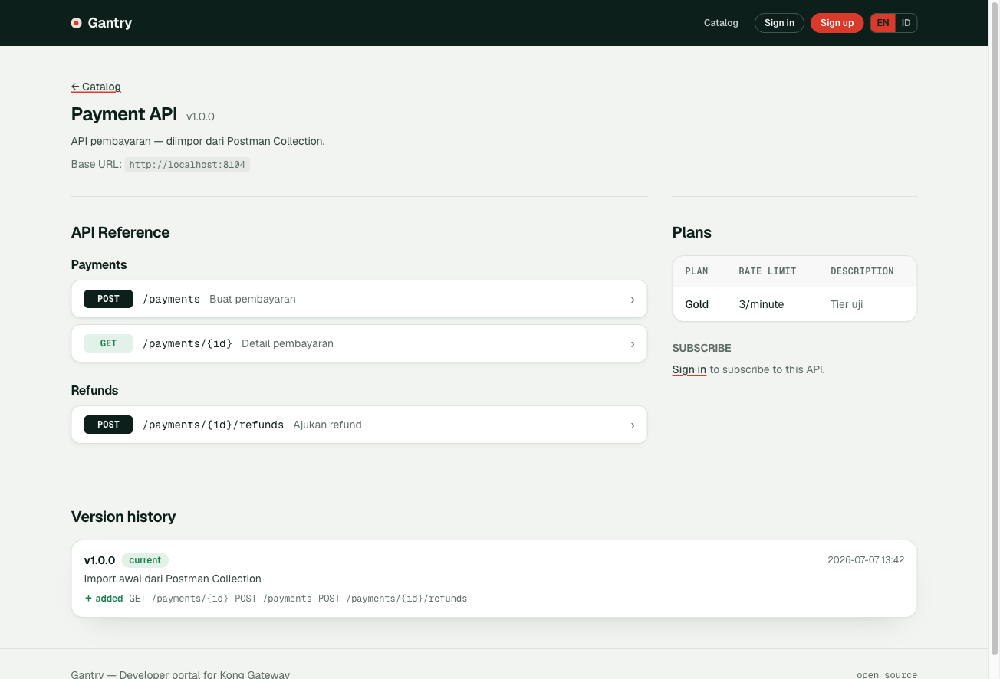

# Gantry

> English version: [README.md](README.md)

**Gantry** adalah **developer portal self-hosted untuk Kong Gateway 3.9**, setara
dengan WSO2 Developer Portal atau Red Hat 3scale Developer Portal untuk tim yang
menjalankan Kong OSS. Developer dapat menemukan API, membuat application,
mendapatkan credential secara mandiri, berlangganan rate-limit plan, dan mencoba
endpoint dari browser; admin mengelola katalog serta approval akses.

- **Stack**: Next.js 16 (App Router, TypeScript, Tailwind 4) · Drizzle ORM · PostgreSQL · Auth.js v5 · next-intl
- **License**: MIT
- Branding dapat diatur melalui `NEXT_PUBLIC_PORTAL_NAME` dan `NEXT_PUBLIC_PORTAL_TAGLINE`; UI tersedia dalam bahasa Inggris dan Indonesia melalui next-intl berbasis cookie.
- Container production sudah divalidasi di Kubernetes dengan deployment Kong sungguhan. Manifest dan network policy yang spesifik per-environment tetap berada di luar repository ini.



| Pemilih theme (admin) | Referensi API |
|---|---|
|  |  |

---

## 1. Konsep inti (WAJIB dibaca sebelum lanjut)

> Ingin mendaftarkan Kong baru (DEV/BIMTEK/PROD) ke portal? Baca
> [docs/kong-integration-requirements.md](docs/kong-integration-requirements.md) —
> daftar syarat plugin, variabel wajib, batas kontrol, dan checklist pendaftaran.

Aplikasi ini mengkurasi API yang di-serve Kong dan memberi developer credential self-service.
Pemetaan konsep:

| Konsep portal | Realisasi di Kong |
|---|---|
| **Application** (milik developer) | 1 Kong **consumer** (`username = app-<uuid>`, tag `devportal`) |
| **Credential** (API Key / JWT) | plugin `key-auth` / `jwt` pada consumer |
| **Subscription** (app → API, per plan) | membership **ACL group** + plugin `rate-limiting` (consumer+service) |
| **Plan / tier** | konfigurasi rate-limit (`{second,minute,hour,day}`) |
| **Blacklist** consumer | plugin `request-termination` pada consumer |
| **Analytics** per app | PromQL filter label `consumer` (butuh prometheus `per_consumer=true`) |

**Prinsip arsitektur yang menentukan banyak keputusan:**

1. **Kong = source of truth untuk routing & credential.** Portal tidak menyimpan secret
   credential (hanya `kong_credential_id` + 4 char hint); secret ditampilkan sekali saja.
2. **OpenAPI spec di portal = dokumentasi murni.** Mengubah spec TIDAK mengubah apa yang
   di-serve Kong. Karena itu "perubahan spec" ditangani sebagai histori+changelog dokumentasi
   (lihat §5), bukan operasi terhadap gateway.
3. **Boundary tegas**: portal HANYA menyentuh entity ber-tag `devportal` (consumer, credential,
   ACL, rate-limiting/request-termination milik consumer). Portal **tidak pernah** membuat/
   mengubah **service atau route** — itu ranah publisher. Portal hanya *membaca* service/route
   (checklist setup, import katalog, tampilan route read-only).
4. Semua akses Kong Admin API lewat satu modul: `src/lib/kong.ts`. Semua akses Prometheus lewat
   `src/lib/metrics.ts`. Keduanya server-side saja.

---

## 2. Setup dev

Prasyarat: Kong Gateway 3.9 (Admin API reachable), PostgreSQL, dan (opsional) Prometheus.
Contoh port di bawah memakai setup dev: Kong admin :8106, proxy :8104, PostgreSQL :6432.

```bash
docker exec kong-postgres psql -U kong -c "CREATE DATABASE kong_devportal;"   # sekali saja
cp .env.example .env.local     # isi AUTH_SECRET: openssl rand -base64 32
npm install
npm run db:migrate
npm run seed:admin             # admin dari ADMIN_EMAIL/ADMIN_PASSWORD di .env.local
npm run dev                    # http://localhost:3000
```

Isi `ADMIN_EMAIL` dan `ADMIN_PASSWORD` di `.env.local`, lalu jalankan
`npm run seed:admin`. Jangan commit credential.
Tanpa `SMTP_HOST`, semua link email (verifikasi, reset password) dicetak ke **console dev server**.

**Prasyarat first-run terhadap Kong**: buka `/admin/setup` sebagai admin — halaman ini
memverifikasi koneksi + prasyarat dan punya tombol **auto-fix** untuk plugin prometheus
`per_consumer`. Jalankan sekali setelah connect ke Kong baru.

### Environment variables

| Var | Wajib | Guna |
|---|---|---|
| `DATABASE_URL` | ✓ | PostgreSQL portal (fail-fast kalau kosong) |
| `AUTH_SECRET` | ✓ | Auth.js + HMAC captcha token |
| `AUTH_URL` | – | origin publik Auth.js; direkomendasikan di belakang reverse proxy |
| `KONG_ADMIN_URL` | ✓ | Kong Admin API (dev `http://localhost:8106`) |
| `PORTAL_BASE_URL` | ✓ | origin publik portal untuk link email dan keamanan cookie CAPTCHA |
| `INTERNAL_EMAIL_DOMAINS` | – | domain yang dipetakan menjadi user `type=internal` |
| `PROMETHEUS_URL` | – | analytics per-app; kalau kosong analytics dinonaktifkan |
| `KONG_PROXY_URL` | – | default proxyBaseUrl saat import katalog (dev `http://localhost:8104`) |
| `SMTP_HOST/PORT/USER/PASS/FROM` | – | email; kalau kosong → console fallback (dev). Auth opsional (relay internal tanpa auth didukung) |
| `ADMIN_EMAIL/ADMIN_PASSWORD` | – | dipakai `npm run seed:admin` |
| `REDIS_URL` | – | rate-limit dan CAPTCHA nonce lintas replica; kosong = in-memory |
| `NEXT_PUBLIC_PORTAL_NAME/TAGLINE` | – | branding (default "Gantry" / "Developer portal for Kong Gateway") |

Untuk production, set `AUTH_URL` dan `PORTAL_BASE_URL` ke origin publik yang
sama. Atribut `Secure` pada cookie CAPTCHA mengikuti scheme `PORTAL_BASE_URL`:
aktif pada HTTPS dan nonaktif pada HTTP. Gunakan HTTP hanya melalui jaringan
internal atau VPN yang tepercaya. Deployment yang menghadap internet sebaiknya
melakukan terminasi HTTPS di reverse proxy dan meneruskan host serta scheme asal.

---

## 3. Perintah

```bash
npm run dev            # dev server (Turbopack)
npm run build          # production build (output: standalone)
npm test               # vitest (34 test)
npm run db:generate    # buat migrasi dari perubahan src/db/schema.ts
npm run db:migrate     # terapkan migrasi
npm run seed:admin     # buat/update user admin
```

Docker: `Dockerfile` (multi-stage, standalone, jalankan `scripts/migrate.mjs` saat start lalu
`server.js`). **Belum pernah di-build/push** — deploy remote sengaja tidak dikerjakan (fokus lokal).

---

## 4. Fitur yang sudah ada (divalidasi E2E dengan Kong sungguhan)

**Auth & user** — signup (verifikasi email + CAPTCHA anti-replay) → approval admin → login;
admin dapat approve sekaligus memverifikasi akun pending secara manual saat SMTP tidak tersedia;
forgot/reset password; ganti password saat login dengan pencabutan seluruh session; kirim ulang
verifikasi; role `developer`/`portal-admin`; rate-limit endpoint auth; suspend user efektif seketika
(cek status DB per-aksi, bukan hanya JWT).

**Katalog (admin)** — CRUD API product; upload/ganti spec **OpenAPI JSON atau Postman
Collection v2** (Postman dikonversi otomatis ke OpenAPI — folder→tag, path var, contoh body &
responses); **import dari Kong**
(`/admin/apis/import`, service yang belum di katalog → draft); siklus status
**draft → published → deprecated → retired** (deprecated tampil + tutup subscription baru,
retired hilang dari katalog); route ditampilkan read-only per service.

**Katalog (developer)** — landing page + katalog kartu (`/`); detail API `/apis/[slug]`:
dokumentasi markdown, **API Reference ala Swagger UI** (accordion per endpoint dengan parameter,
contoh request/response dari schema — `$ref` di-resolve, grup per tag), plans, subscribe,
**Try-It console** (endpoint picker custom), riwayat versi.

**Application & credential** — buat app (= consumer), generate API Key/JWT (tampil sekali),
revoke; halaman `/apps` & `/apps/[id]`.

**Subscription** — developer request (app+plan) → antrian approval admin (`/admin/subscriptions`)
→ approve menulis ACL+rate-limit ke Kong (rollback bila gagal) → revoke menghapusnya;
re-subscribe setelah revoked/rejected.

**Konsistensi Kong** — mutasi database dan Kong memakai compensating rollback atau fail closed.
Operasi cleanup melakukan retry, error awal dari Kong tetap dipertahankan saat rollback atau
revocation credential gagal, dan consumer tidak dihapus selama masih memiliki referensi.

**Deployment** — image production standalone sudah divalidasi di Kubernetes, termasuk akses
melalui HTTP NodePort pada VPN tepercaya. Deployment HTTPS di belakang reverse proxy didukung;
manifest, secret, dan network policy tetap dikelola oleh masing-masing environment.

**Consumer management (admin)** — `/admin/consumers`: blacklist/unblock (request-termination),
revoke credential siapa pun, hapus app.

**Try-It console** — `/api/try` proxy server-side (target terkunci ke proxyBaseUrl produk,
bukan open relay); developer menempel API key-nya sendiri. Body JSON plus upload file
`multipart/form-data` yang dideklarasikan di spec (batas 10 MB agregat, 3 upload bersamaan);
envelope respons memuat status, header terpilih, dan 100 KB pertama body. Header request
tambahan hanya diteruskan bila dideklarasikan spec (`in: header`, level path-item atau
operation) atau untuk `Authorization`; selain itu ditolak 400.

**Analytics** — pemakaian per app (request per service×status, dari PromQL label consumer).

**Setup/sanity** — `/admin/setup`: cek Kong reachable+versi, plugin tersedia, prometheus
per_consumer (auto-fix), status Prometheus/SMTP/proxy.

**Audit log** — `/admin/audit`: semua aksi teraudit; filter proper (aksi/entity/aktor dari
nilai distinct, rentang tanggal, cari payload), paginasi, URL shareable.

**Filter list admin** — semua halaman daftar admin (APIs/Plans/Subscriptions/Consumers/Users)
punya `FilterBar` seragam berbasis query-param.

**UI/desain** — design system "switchyard" (token + komponen di `globals.css`: `btn-*`, `card`,
`table-base`, `badge-*`, `input`, `section-title`), shell `SiteHeader`/`SiteFooter` di semua
halaman, `NavLink` dengan indikator halaman aktif, tabel gaya kartu. Semua aksi destruktif
(delete/retire/revoke/block/suspend) minta konfirmasi (prop `confirm` di `PendingButton`);
delete plan yang masih dipakai subscription di-disable.

**Theme selector** — theme site-wide dipilih admin di `/admin/appearance`, berlaku seketika
untuk semua pengunjung. 6 theme bawaan (istilah perkeretaapian, bukan nama brand): `switchyard`
(default), `mainline`, `heritage`, `horizon`, `twilight`, `semaphore`. Tersimpan di tabel
`portal_settings`; root layout membaca lalu memasang `data-theme` di `<html>` (tanpa client JS,
tanpa flash). Cara bikin theme custom: lihat §4a.

**i18n** — next-intl **mode cookie** (URL tidak berubah), default **English**, terjemahan
Indonesia penuh untuk permukaan publik/developer + pesan action + email; `LocaleSwitcher`
EN/ID di header. Tambah bahasa: buat `messages/<kode>.json` + daftarkan di `LOCALES`
(`src/i18n/request.ts`). UI admin saat ini English (lihat roadmap).

**Spec versioning** — tiap upload spec baru → snapshot berversi + **diff endpoint otomatis**
(added/removed/changed) + deteksi **breaking** (endpoint dihapus); riwayat di halaman API & admin.

### 4a. Membuat theme custom

Theme = satu set override CSS variable; komponen tidak perlu disentuh. Tiga langkah:

1. **Daftarkan** di `src/lib/themes.ts` — tambah entri `THEMES`:
   `{ key, name, description, fontVar, swatch: [paper, ink, accent] }`.
2. **Definisikan warnanya** di `src/app/globals.css` — blok `[data-theme="<key>"]` yang
   meng-override variable dari `@theme`:

   ```css
   [data-theme="contoh"] {
     --color-paper: #f4f6fa;   /* background halaman */
     --color-ink: #1a2340;     /* teks utama + surface gelap (header/hero) */
     --color-ink-soft: #3c4668;
     --color-line: #d5d9e4;    /* border */
     --color-muted: #667089;   /* teks sekunder */
     --color-amber: #e8590c;   /* accent: fokus, tombol accent, sinyal */
     --color-amber-deep: #b74407;  /* hover tombol accent */
     --color-accent-ink: #ffffff;  /* teks di atas accent — putih bila accent gelap */
     --font-display: var(--font-archivo), ui-sans-serif, system-ui;
   }
   ```

3. **Font display** (opsional) — kalau butuh font baru, load via `next/font` di
   `src/app/layout.tsx` dengan `variable: "--font-<nama>"`, ikut pola yang ada.

Catatan: warna status (`go`/`warn`/`stop`) sengaja sama di semua theme; jaga kontras AA
(≥4.5:1) antara `accent-ink`↔`amber` dan `ink`↔`paper`. Kalau accent terlalu terang untuk
focus ring (kasus `mainline`), override: `[data-theme="<key>"] :focus-visible { outline-color: … }`.

### Peta kode

```
src/lib/kong.ts          semua panggilan Kong Admin API (satu-satunya)
src/lib/metrics.ts       PromQL analytics
src/lib/openapi-diff.ts  diff endpoint antar spec (unit-tested)
src/lib/postman.ts       konversi Postman Collection v2 -> OpenAPI (unit-tested)
src/lib/redis.ts         klien Redis opsional (rate-limit/nonce)
src/lib/themes.ts        registry theme + getTheme() (baca portal_settings)
src/i18n/request.ts      konfigurasi next-intl (cookie locale); messages/{en,id}.json
src/lib/require-admin.ts requireUser/requireAdmin (cek status+role dari DB)
src/lib/{captcha,rate-limit,tokens,password,mailer,audit,db-errors}.ts
src/actions/*.ts         server actions (admin-products/plans/consumers/setup/users, apps, subscriptions, signup, login, password-reset)
src/app/                 halaman (admin/*, apis/*, apps/*, auth/*, api/try, api/captcha)
src/db/schema.ts         11 tabel; migrasi di drizzle/0000..0004
```

---

## 5. Roadmap

Fitur inti sudah divalidasi secara E2E, termasuk pada deployment Kubernetes.
Item berikut belum masuk scope implementasi saat ini.

### Ditunda secara sadar
- **Spec-change lanjutan** (scope saat ini hanya history + auto-diff):
  - *Deteksi breaking + notifikasi subscriber*: sudah ada `hasBreakingChange()` di
    `openapi-diff.ts` dan badge "breaking"; tinggal tambah banner di `/apis/[slug]` untuk
    subscriber + entri di `/apps/[id]`, opsional email.
  - *Major version = product v2 tertaut* (ala 3scale): alur clone product jadi v2 (slug/ACL/
    service sendiri) + kolom penaut antar-versi, supaya subscriber v1 tetap jalan.

### Backlog teknis (status per Jul 2026)
- ~~Rate-limit & captcha nonce in-memory~~ **SELESAI**: kini Redis-backed bila `REDIS_URL`
  diset (aman lintas replica), dengan fallback in-memory bila kosong atau tidak tersedia
  (`src/lib/redis.ts`).
- ~~Latency agregat per produk~~ **SELESAI**: `serviceLatencyP95()` di `src/lib/metrics.ts`
  (histogram `kong_request_latency_ms_bucket`, butuh `latency_metrics=true` — auto-fix Setup
  sudah mencakupnya); tampil di halaman detail API. Catatan: seri histogram baru butuh ≥2
  scrape Prometheus sebelum `rate()` menghasilkan nilai (bukan bug).
- ~~Pending-state tombol admin~~ **SELESAI**: `PendingButton` (useFormStatus) dipakai di semua
  form aksi admin.
- **Email-enumeration** di signup (pesan "Email sudah terdaftar"): user **terima risiko** untuk
  portal tertutup ber-approval. Netralkan pesan bila portal jadi lebih terbuka.

### Backlog tambahan
- **i18n halaman admin**: UI admin masih English hardcode; infrastruktur next-intl sudah ada —
  tinggal ekstraksi string ke `messages/*.json` (ikuti pola halaman publik).
- **Open-source housekeeping**: tambahkan panduan kontribusi (`CONTRIBUTING.md`).

### Ide fitur lanjutan (belum di-scope)
- Notifikasi email saat subscription di-approve/reject.
- Multi-gateway dalam satu portal (kini 1 deployment = 1 Kong via `KONG_ADMIN_URL`).
- Portal membuat/menghapus **route** Kong (perubahan boundary — saat ini route read-only).

---

## 6. Catatan penting untuk kontributor

- **Next.js 16**: konvensi middleware = `src/proxy.ts` (bukan `middleware.ts`); `svg-captcha`
  didaftarkan di `serverExternalPackages`. Baca `AGENTS.md` — versi ini beda dari training data.
- **Cache Turbopack basi**: kalau edit `globals.css`/`next.config.ts` tidak terlihat efeknya
  bahkan setelah restart dev server → `rm -rf .next` lalu start ulang.
- **Popup `<select>` native** dirender OS (posisi/tema di luar kendali halaman) — untuk dropdown
  yang butuh styling, pakai pola `EndpointPicker` (custom listbox) di `TryIt.tsx`.
- **String UI**: jangan hardcode — pakai next-intl (`useTranslations`/`getTranslations`) dan
  tambahkan key ke `messages/en.json` + `messages/id.json`.
- **Error drizzle**: deteksi unique-violation via `isUniqueViolation()` (SQLSTATE bisa di
  `err.code` atau `err.cause.code`), jangan cek `err.code` langsung.
- **Boundary Kong**: jangan tambah kode yang membuat/ubah service/route di `lib/kong.ts` tanpa
  keputusan eksplisit — itu memutus prinsip §1.3.
- Verifikasi perubahan dengan E2E nyata terhadap Kong (panggil proxy sampai 200/401/403/429),
  bukan hanya unit test — pola ini dipakai konsisten selama pengembangan.
