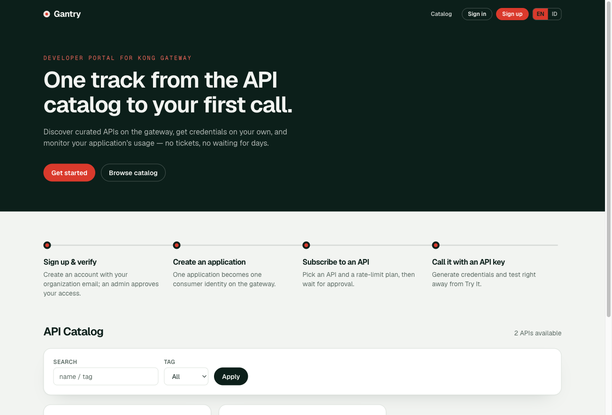
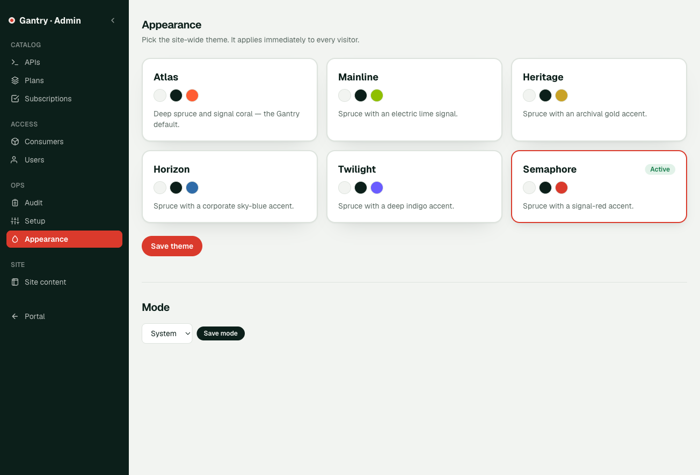
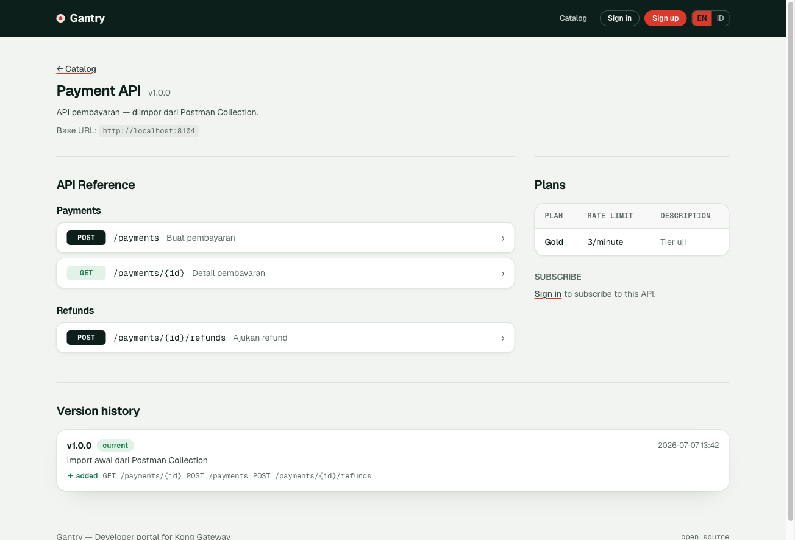

# Gantry

**Gantry** is a self-hosted **developer portal for Kong Gateway 3.9** — the
counterpart of WSO2 Developer Portal or Red Hat 3scale Developer Portal, for
teams that run plain Kong OSS. Developers discover curated APIs, create
applications, get credentials self-service, subscribe to rate-limit plans, and
try endpoints from the browser; admins curate the catalog and approve access.

> Dokumentasi Bahasa Indonesia: [README.id.md](README.id.md)

- **Stack**: Next.js 16 (App Router, TypeScript, Tailwind 4) · Drizzle ORM · PostgreSQL · Auth.js v5 · next-intl
- **License**: MIT
- Branding is configurable (`NEXT_PUBLIC_PORTAL_NAME` / `NEXT_PUBLIC_PORTAL_TAGLINE`); UI is English with full Indonesian translation (cookie-based next-intl).
- The production container has been validated on Kubernetes against a real Kong deployment. Environment-specific manifests and network policies stay outside this repository.



| Theme selector (admin) | API reference |
|---|---|
|  |  |

---

## 1. Core concepts (read this first)

The portal curates APIs already served by Kong and gives developers
self-service credentials. Concept mapping:

| Portal concept | Realized in Kong as |
|---|---|
| **Application** (owned by a developer) | one Kong **consumer** (`username = app-<uuid>`, tag `devportal`) |
| **Credential** (API Key / JWT) | `key-auth` / `jwt` plugin on the consumer |
| **Subscription** (app → API, per plan) | **ACL group** membership + `rate-limiting` plugin (consumer+service) |
| **Plan / tier** | rate-limit config (`{second,minute,hour,day}`) |
| **Consumer blacklist** | `request-termination` plugin on the consumer |
| **Per-app analytics** | PromQL filtered by the `consumer` label (needs prometheus `per_consumer=true`) |

**Architectural principles that drive most decisions:**

1. **Kong is the source of truth for routing & credentials.** The portal never
   stores credential secrets (only `kong_credential_id` + a 4-char hint); the
   secret is shown exactly once.
2. **OpenAPI specs in the portal are documentation only.** Changing a spec does
   NOT change what Kong serves. "Spec changes" are therefore handled as
   documentation history + changelog (§5), not gateway operations.
3. **Hard boundary**: the portal only touches entities tagged `devportal`
   (consumers, credentials, ACLs, per-consumer plugins). It **never** creates
   or mutates **services or routes** — that is publisher territory. It only
   *reads* services/routes (setup checklist, catalog import, read-only route
   display).
4. All Kong Admin API access goes through one module: `src/lib/kong.ts`; all
   Prometheus access through `src/lib/metrics.ts`. Both server-side only.

---

## 2. Dev setup

Prerequisites: Kong Gateway 3.9 with a reachable Admin API, PostgreSQL, and
(optionally) Prometheus scraping Kong. The examples below use a local dev
stack with Kong admin on :8106, proxy on :8104, PostgreSQL on :6432.

```bash
createdb kong_devportal            # or: docker exec <pg> psql -U kong -c "CREATE DATABASE kong_devportal;"
cp .env.example .env.local         # set AUTH_SECRET: openssl rand -base64 32
npm install
npm run db:migrate
npm run seed:admin                 # creates the admin from ADMIN_EMAIL/ADMIN_PASSWORD in .env.local
npm run dev                        # http://localhost:3000
```

Log in with the admin credentials you set in `.env.local`.
Without `SMTP_HOST`, all email links (verification, password reset) are
printed to the **dev server console**.

**First-run against a Kong instance**: open `/admin/setup` as admin — it
verifies connectivity + prerequisites and has an **auto-fix** button for the
prometheus plugin (`per_consumer`, `latency_metrics`). Run it once per Kong.

### Environment variables

| Var | Required | Purpose |
|---|---|---|
| `DATABASE_URL` | ✓ | portal PostgreSQL (fails fast when empty) |
| `AUTH_SECRET` | ✓ | Auth.js + captcha token HMAC |
| `AUTH_URL` | – | public Auth.js origin; recommended behind a reverse proxy |
| `KONG_ADMIN_URL` | ✓ | Kong Admin API (dev `http://localhost:8106`) |
| `PORTAL_BASE_URL` | ✓ | public portal origin for email links and CAPTCHA cookie security |
| `INTERNAL_EMAIL_DOMAINS` | – | domains mapped to `type=internal` users |
| `PROMETHEUS_URL` | – | per-app analytics; empty disables analytics |
| `KONG_PROXY_URL` | – | default proxyBaseUrl during catalog import (dev `http://localhost:8104`) |
| `SMTP_HOST/PORT/USER/PASS/FROM` | – | email; empty → console fallback (dev). Auth optional (no-auth internal relays supported) |
| `ADMIN_EMAIL/ADMIN_PASSWORD` | – | used by `npm run seed:admin` |
| `REDIS_URL` | – | rate-limit & captcha nonce across replicas; empty = in-memory |
| `NEXT_PUBLIC_PORTAL_NAME/TAGLINE` | – | branding (default "Gantry" / "Developer portal for Kong Gateway") |

Set `AUTH_URL` and `PORTAL_BASE_URL` to the same public origin in production.
The CAPTCHA cookie follows the `PORTAL_BASE_URL` scheme: `Secure` is enabled
for HTTPS and disabled for HTTP. Use HTTP only on trusted internal or VPN
paths; internet-facing deployments should terminate HTTPS at a reverse proxy
and forward the original host and scheme.

---

## 3. Commands

```bash
npm run dev            # dev server (Turbopack)
npm run build          # production build (output: standalone)
npm test               # vitest (34 tests)
npm run db:generate    # generate a migration from src/db/schema.ts changes
npm run db:migrate     # apply migrations
npm run seed:admin     # create/update the admin user
```

Docker: `Dockerfile` (multi-stage, standalone; runs `scripts/migrate.mjs` on
start, then `server.js`).

---

## 4. Features (all verified E2E against a real Kong)

**Auth & users** — signup (email verification + anti-replay captcha) → admin
approval → login; an admin can approve and verify a pending account manually
when SMTP is unavailable; forgot/reset password; resend verification; roles
`developer`/`portal-admin`; rate-limited auth endpoints; suspending a user
takes effect immediately (DB status checked per action, not just the JWT).

**Catalog (admin)** — CRUD API products; upload/replace specs as **OpenAPI
JSON or Postman Collection v2** (Postman auto-converted to OpenAPI —
folders→tags, path vars, body & response examples); **import from Kong**
(`/admin/apis/import`, services not yet in the catalog become drafts); status
lifecycle **draft → published → deprecated → retired** (deprecated stays
visible and closes new subscriptions, retired disappears); read-only route
display per service.

**Catalog (developer)** — landing page + card catalog (`/`); API detail
`/apis/[slug]`: markdown docs, **Swagger-style API reference** (accordion per
endpoint with parameters, request/response examples derived from schemas —
`$ref` resolved, grouped by tag), plans, subscribe, **Try-It console**,
version history.

**Applications & credentials** — create an app (= consumer), generate API
Key/JWT (shown once), revoke; `/apps` and `/apps/[id]`.

**Subscriptions** — developer requests (app+plan) → admin approval queue
(`/admin/subscriptions`) → approve writes ACL+rate-limit to Kong (rolls back
on failure) → revoke removes them; re-subscribe after revoked/rejected.

**Kong consistency** — database and Kong mutations use compensating rollback
or fail closed. Cleanup operations retry, credential rollback/revocation keeps
the original Kong error, and consumers are not deleted while still referenced.

**Deployment** — the standalone production image has been validated on
Kubernetes, including access over an HTTP NodePort on a trusted VPN. HTTPS
reverse-proxy deployments are supported; manifests, secrets, and network
policies remain environment-owned.

**Consumer management (admin)** — `/admin/consumers`: blacklist/unblock
(request-termination), revoke anyone's credential, delete apps.

**Try-It console** — `/api/try` server-side proxy (target locked to the
product's proxyBaseUrl — not an open relay); developers paste their own key.

**Analytics** — per-app usage (requests per service×status via the PromQL
`consumer` label) and p95 latency per service.

**Setup/sanity** — `/admin/setup`: Kong reachability+version, available
plugins, prometheus flags (auto-fix), Prometheus/SMTP/proxy status.

**Audit log** — `/admin/audit`: every action audited; filters (action/entity/
actor from distinct values, date range, payload search), pagination,
shareable URLs.

**Admin list filters** — every admin list page shares a query-param based
`FilterBar`.

**UI/design** — "switchyard" design system (tokens + components in
`globals.css`: `btn-*`, `card`, `table-base`, `badge-*`, `input`,
`section-title`), `SiteHeader`/`SiteFooter` shell, `NavLink` active states,
card-style tables. Destructive actions (delete/retire/revoke/block/suspend)
ask for confirmation (`confirm` prop on `PendingButton`); deleting a plan
that subscriptions still use is disabled.

**Theme selector** — admins pick a site-wide theme at `/admin/appearance`;
it applies to every visitor instantly. Six built-in themes (railway-flavored
names): `switchyard` (default), `mainline`, `heritage`, `horizon`,
`twilight`, `semaphore`. Stored in `portal_settings`; the root layout sets
`data-theme` on `<html>` (no client JS, no flash).

**i18n** — next-intl in **cookie mode** (URLs don't change), default
**English**, full Indonesian translation of the public/developer surface +
action messages + emails; `LocaleSwitcher` in the header. Add a language:
create `messages/<code>.json` + register it in `LOCALES`
(`src/i18n/request.ts`). Admin UI is currently English (see roadmap).

**Spec versioning** — each spec upload → versioned snapshot + **automatic
endpoint diff** (added/removed/changed) + **breaking** detection (removed
endpoints); history on both the public API page and the admin edit page.

### 4a. Creating a custom theme

A theme is a set of CSS-variable overrides; components are untouched. Three steps:

1. **Register it** in `src/lib/themes.ts` — add a `THEMES` entry:
   `{ key, name, description, fontVar, swatch: [paper, ink, accent] }`.
2. **Define the colors** in `src/app/globals.css` — a `[data-theme="<key>"]`
   block overriding the `@theme` variables:

   ```css
   [data-theme="example"] {
     --color-paper: #f4f6fa;   /* page background */
     --color-ink: #1a2340;     /* main text + dark surfaces (header/hero) */
     --color-ink-soft: #3c4668;
     --color-line: #d5d9e4;    /* borders */
     --color-muted: #667089;   /* secondary text */
     --color-amber: #e8590c;   /* accent: focus, accent buttons, signals */
     --color-amber-deep: #b74407;  /* accent button hover */
     --color-accent-ink: #ffffff;  /* text on accent — white when accent is dark */
     --font-display: var(--font-archivo), ui-sans-serif, system-ui;
   }
   ```

3. **Display font** (optional) — load new fonts via `next/font` in
   `src/app/layout.tsx` with `variable: "--font-<name>"`, following the
   existing pattern.

Notes: status colors (`go`/`warn`/`stop`) are intentionally shared across
themes; keep AA contrast (≥4.5:1) between `accent-ink`↔`amber` and
`ink`↔`paper`. If the accent is too light for a visible focus ring (see
`mainline`), override it:
`[data-theme="<key>"] :focus-visible { outline-color: … }`.

### Code map

```
src/lib/kong.ts          every Kong Admin API call (the only place)
src/lib/metrics.ts       PromQL analytics
src/lib/openapi-diff.ts  endpoint diff between specs (unit-tested)
src/lib/postman.ts       Postman Collection v2 -> OpenAPI conversion (unit-tested)
src/lib/redis.ts         optional Redis client (rate-limit/nonce)
src/lib/themes.ts        theme registry + getTheme() (reads portal_settings)
src/i18n/request.ts      next-intl config (cookie locale); messages/{en,id}.json
src/lib/require-admin.ts requireUser/requireAdmin (status+role checked in DB)
src/lib/{captcha,rate-limit,tokens,password,mailer,audit,db-errors}.ts
src/actions/*.ts         server actions
src/app/                 pages (admin/*, apis/*, apps/*, auth/*, api/try, api/captcha)
src/db/schema.ts         11 tables; migrations in drizzle/0000..0004
```

---

## 5. Roadmap

### Deliberately deferred
- **Advanced spec-change handling** (current scope = history + auto-diff):
  - *Breaking-change detection + subscriber notification*:
    `hasBreakingChange()` and the "breaking" badge already exist; what's left
    is a banner on `/apis/[slug]` for subscribers + an entry on `/apps/[id]`,
    optionally email.
  - *Major version = linked v2 product* (3scale-style): clone a product to v2
    (own slug/ACL/service) + a linking column, so v1 subscribers keep working.

### Backlog
- **Admin page i18n**: admin UI is hardcoded English; next-intl
  infrastructure is in place — extract strings to `messages/*.json` following
  the public-page pattern.
- **Email-enumeration** on signup ("email already registered"): accepted risk
  for a closed, approval-gated portal. Neutralize the message if the portal
  becomes more open.

### Feature ideas (not scoped)
- Email notification on subscription approve/reject.
- Multi-gateway in one portal (currently 1 deployment = 1 Kong via `KONG_ADMIN_URL`).
- Portal-managed Kong **routes** (a boundary change — routes are read-only today).

---

## 6. Notes for contributors

See [CONTRIBUTING.md](CONTRIBUTING.md). Highlights:

- **Next.js 16**: middleware lives in `src/proxy.ts` (not `middleware.ts`);
  `svg-captcha` is registered in `serverExternalPackages`. Read `AGENTS.md` —
  this version differs from most training data.
- **Stale Turbopack cache**: if edits to `globals.css`/`next.config.ts` have
  no visible effect even after a dev-server restart → `rm -rf .next` and start again.
- **Native `<select>` popups** are OS-rendered (position/theme beyond the
  page's control) — for styled dropdowns use the `EndpointPicker` pattern
  (custom listbox) in `TryIt.tsx`.
- **UI strings**: don't hardcode — use next-intl and add keys to both
  `messages/en.json` and `messages/id.json`.
- **Drizzle errors**: detect unique violations via `isUniqueViolation()`
  (SQLSTATE may be on `err.code` or `err.cause.code`).
- **Kong boundary**: don't add code that creates/mutates services or routes
  in `lib/kong.ts` without an explicit decision — it breaks principle §1.3.
- Verify changes with real E2E against Kong (call the proxy until you see the
  actual 200/401/403/429), not unit tests alone.
