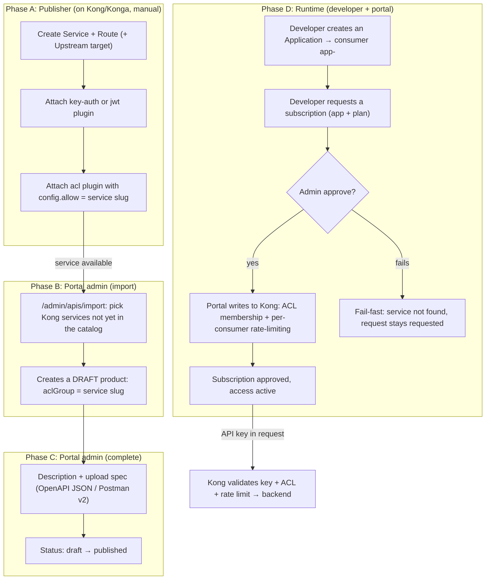

# Kong Integration Requirements

This document details what a Kong instance must satisfy so that Gantry can inspect
its state and manage it. The checks live on the `/admin/setup` and
`/admin/apis/[id]` pages; this document moves those runtime requirements here,
so they can be verified **before** pointing the portal at a new Kong.

Audience: engineers registering a new Kong with the portal, and publishers
preparing services/routes for new products.

> Versi Bahasa Indonesia: [kong-integration-requirements.md](kong-integration-requirements.md) — keduanya setara.

## 1. Control Boundary

Gantry manages Kong through the Admin API under the following constraint. The
source of truth is `src/lib/kong.ts`: there is no POST/PUT/PATCH against
services or routes.

| Gantry may write (entities tagged `devportal`) | Gantry reads only |
|---|---|
| consumer (`username = app-<uuid>`) | service |
| credential `key-auth` / `jwt` | route |
| ACL membership per consumer | upstream |
| `rate-limiting` scoped consumer+service | plugins on services/routes |
| `request-termination` (consumer blacklist) | |

Given that boundary, **product services and routes are the publisher's
responsibility**. The publisher creates them in Kong directly, not through the
portal; Gantry afterwards imports the existing service as a catalog draft. The
portal never creates services or routes.

## 2. Environment

| Component | Required | Detail |
|---|---|---|
| Kong Gateway 3.9+ | yes | version read from `GET /`; the portal does not enforce a minimum version; 3.9 is the reference because all six required plugins exist in that release (re-check when upgrading Kong) |
| Admin API reachable from the Gantry container | yes | configured through `KONG_ADMIN_URL` (Section 4) |
| PostgreSQL | yes | `DATABASE_URL`; migrations run via `scripts/migrate.mjs` at container start |
| Prometheus | optional | `PROMETHEUS_URL` for per-app analytics; when absent, analytics are off but the portal still works |
| Redis | optional | when `REDIS_URL` is empty, rate limiting and CAPTCHA use in-memory storage; safe for a single replica only |
| SMTP | optional | when `SMTP_HOST` is empty, verification/reset links appear only in the server log |

## 3. Requirements on Kong

### 3.1 Plugins that must exist on the server

The following six plugins must appear in `plugins.available_on_server` (the
`GET /` response), matching the `REQUIRED_PLUGINS` constant in
`src/app/admin/setup/page.tsx`:

```
key-auth, jwt, acl, rate-limiting, request-termination, prometheus
```

The `/admin/setup` page checks availability, lists per-plugin status, and
reports `Missing: ...` when something is absent. Plugin → portal feature
mapping:

| Plugin | Portal feature that depends on it |
|---|---|
| `key-auth` | issuing and verifying API Keys |
| `jwt` | issuing JWT credentials |
| `acl` | subscription access groups |
| `rate-limiting` | enforcing plan quotas |
| `request-termination` | blacklisting applications |
| `prometheus` | per-application usage analytics |

### 3.2 Global `prometheus` plugin

There must be exactly one `prometheus` plugin **globally** (no
`service`/`route`/`consumer`) with `enabled=true` and this configuration:

| Config | Required value | Impact when wrong |
|---|---|---|
| `per_consumer` | `true` | analytics metrics lack the `consumer` label |
| `latency_metrics` | `true` | p95 latency is not recorded |

While any of those values is wrong, the setup page offers a
**Fix automatically** button (`fixPrometheusPlugin` in
`src/actions/admin-setup.ts`) to correct it.

### 3.3 Product service (publisher checklist)

For every service that will be published, `checkServiceSetup` in
`src/lib/kong.ts` checks four things:

1. The `service` object exists in Kong.
2. A `key-auth` **or** `jwt` plugin is attached with `enabled=true`.
3. An `acl` plugin is attached with `enabled=true`.
4. The `acl` plugin's `config.allow` includes the product's ACL group.

All four are configured by the publisher directly on Kong, not in the portal.
The portal only reads them and renders them as a checklist on the admin API
page.

### 3.4 New product onboarding flow (end-to-end)

The full sequence from a new service on Kong until developers can use it.
Three links between phases matter:

1. **The `aclGroup` follows the Kong service name.** At import, the portal
   derives `aclGroup` from the service's slug (`importProducts`,
   `src/actions/admin-products.ts:178` — `aclGroup: slug`). The `acl` plugin
   the publisher attaches in phase A must carry that same slug in
   `config.allow`; if they differ, approved subscriptions still hit the 403
   from the `acl` plugin.
2. **Per-consumer quota is written by the portal, not the publisher.** The
   publisher only attaches authentication + `acl`. When a subscription is
   approved, `approveSubscription` (`src/actions/subscriptions.ts:76`) adds
   the ACL membership and a per consumer+service `rate-limiting` plugin; a
   failure mid-way is rolled back (plugins deleted, ACL removed, subscription
   stays `requested`).
3. **Approval is fail-fast on the Kong service.** If the service is missing
   from Kong (`subscriptions.ts:84`), approval is rejected with a message
   pointing at Admin › APIs — the request itself is left untouched.



Outcome per phase:

| Phase | Actor | Produced | If skipped |
|---|---|---|---|
| A: Kong/Konga | Publisher (manual) | service, route, auth plugin, `acl.allow` | import finds no service, or approval hits 403 |
| B: Import | Portal admin | draft product (aclGroup = slug) | product is absent from the catalog |
| C: Complete | Portal admin | description, spec, published status | product is invisible in the public catalog |
| D: Runtime | Developer + admin | application, subscription, credential | developers cannot obtain access |

## 4. Portal Environment Variables

| Variable | Required | Purpose |
|---|---|---|
| `KONG_ADMIN_URL` | yes | Admin API used for all Kong operations |
| `KONG_PROXY_URL` | optional | initial `proxyBaseUrl` used during catalog import |
| `PROMETHEUS_URL` | optional | Prometheus `/-/ready` endpoint checked for analytics readiness |

The setup page also verifies non-Kong items: SMTP and Prometheus.

## 5. The Four-URL Separation

The portal operates on four distinct URLs; mixing them is a common source of
connectivity failures:

| Used by | Configuration | Purpose |
|---|---|---|
| Developer browsers | `PORTAL_BASE_URL` (+ `AUTH_URL` behind a reverse proxy) | login, catalog, applications |
| Portal `Try-It` server-side | `KONG_PROXY_URL` | the portal makes requests to Kong, not the browser |
| External consumers | `servers[].url` in OpenAPI | documentation, not a portal path |
| Portal → Kong management | `KONG_ADMIN_URL` | consumer/credential/ACL/rate-limit operations |

Set the scheme correctly: when the portal runs on an internal HTTP address,
`PORTAL_BASE_URL` must use `http://`. Do not collapse ports with different
roles; pointing `KONG_ADMIN_URL` and `KONG_PROXY_URL` at the same host and port
breaks `Try It`: a 502 when requests reach the wrong endpoint, or a refused
connection when a NetworkPolicy separates the portal pod from Kong.

## 6. Security

1. **The Admin API is not a public endpoint.** Only the portal and infrastructure
   administrators need access. Check the binding: when Kong listens on
   `0.0.0.0:8001`, access is available from the whole subnet. Tighten it with
   `127.0.0.1` binding, a NetworkPolicy, a firewall, or another network-level
   mechanism.
2. **RBAC is unavailable in Kong open-source.** In setups without Kong
   Enterprise, network isolation is the only active protection; treat
   port `8001` as an admin interface.
3. **Rate limiting across nodes:** `rate-limiting` with `policy=local` counts
   quota per node. With several Kong nodes serving the same plan, the effective
   total quota is approximately plan quota × node count; switching to
   `policy=redis` makes all nodes share one quota counter.

## 7. New Kong Registration Checklist

- [ ] Kong 3.9+ running; the Admin API is reachable from the portal container
      through `KONG_ADMIN_URL`
- [ ] The `GET /` response shows the Kong version and `available_on_server`
      includes all six required plugins
- [ ] Global `prometheus` plugin: `per_consumer=true`, `latency_metrics=true`
      (`/admin/setup` offers an automatic fix)
- [ ] For each product: the service exists (created by the publisher); a
      `key-auth` or `jwt` plugin is attached; an `acl` plugin is attached with
      the product group in `config.allow`
- [ ] `KONG_PROXY_URL` is set as the initial proxy URL for catalog import
- [ ] (optional, production) `PROMETHEUS_URL` is set for analytics
- [ ] Open `/admin/setup`, confirm every row is green, then point the portal at
      this Kong