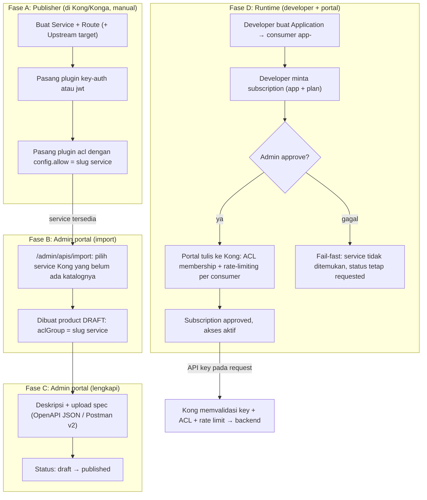

# Kong Integration Requirements

> English version: [kong-integration-requirements.en.md](kong-integration-requirements.en.md)

Dokumen ini merinci apa yang harus dipenuhi sebuah instance Kong agar dapat dilihat
laporannya dan dikelola oleh Gantry. Sumber pengecekannya adalah halaman `/admin/setup` dan
`/admin/apis/[id]`; dokumen ini memindahkan syarat tersebut dari halaman runtime ke
sini, agar pengecekan dapat dilakukan **sebelum** portal diarahkan ke Kong baru.

Audience: engineer yang mendaftarkan Kong baru ke portal, atau publisher yang
menyiapkan service/route untuk produk baru.

## 1. Batas Kontrol

Gantry mengelola Kong melalui Admin API dengan batasan berikut. Kode sumbernya ada
di `src/lib/kong.ts`: tidak ada operasi POST/PUT/PATCH terhadap service atau route.

| Gantry boleh tulis (entity ber-tag `devportal`) | Gantry hanya baca |
|---|---|
| consumer (`username = app-<uuid>`) | service |
| credential `key-auth` / `jwt` | route |
| ACL membership per consumer | upstream |
| `rate-limiting` scope consumer+service | plugin pada service/route |
| `request-termination` (blacklist consumer) | |

Karena batasan itu, **service dan route produk adalah tanggung jawab publisher**.
Publisher membuat objek itu di Kong, tanpa melalui portal; Gantry kemudian meng-*import*
service yang ada sebagai draft katalog; portal tidak pernah membuat service/route.

## 2. Lingkungan

| Komponen | Status | Detail |
|---|---|---|
| Kong Gateway 3.9+ | wajib | versi diambil dari `GET /`; portal tidak memvalidasi batas minimum versi; 3.9 menjadi acuan; keenam plugin wajib tersedia di release ini (cek ulang saat upgrade Kong) |
| Admin API reachable dari container Gantry | wajib | dikonfigurasi lewat `KONG_ADMIN_URL` (Bagian 4) |
| PostgreSQL | wajib | `DATABASE_URL`; migrasi dijalankan `scripts/migrate.mjs` saat container start |
| Prometheus | opsional | `PROMETHEUS_URL` untuk analitik per-aplikasi; jika kosong, analitik nonaktif namun portal tetap berfungsi |
| Redis | opsional | jika `REDIS_URL` kosong, rate-limit dan CAPTCHA memakai penyimpanan in-memory; hanya aman untuk satu replica |
| SMTP | opsional | jika `SMTP_HOST` kosong, link verifikasi/reset hanya muncul di log server |

## 3. Syarat pada Kong

### 3.1 Plugin yang harus tersedia di server

Enam plugin berikut harus ada di `plugins.available_on_server` (respons `GET /`),
sesuai konstanta `REQUIRED_PLUGINS` di `src/app/admin/setup/page.tsx`:

```
key-auth, jwt, acl, rate-limiting, request-termination, prometheus
```

Halaman `/admin/setup` memeriksa ketersediaannya, menampilkan status per plugin,
dan menandai `Missing: ...` bila ada yang kurang. Pemetaan plugin ke fitur portal:

| Plugin | Fitur portal yang bergantung padanya |
|---|---|
| `key-auth` | penerbitan dan verifikasi API Key |
| `jwt` | penerbitan credential JWT |
| `acl` | grup akses subscription |
| `rate-limiting` | penegakan kuota plan |
| `request-termination` | blacklist aplikasi |
| `prometheus` | analitik penggunaan per aplikasi |

### 3.2 Plugin `prometheus` global

Harus ada satu plugin `prometheus` **global** (tanpa `service`/`route`/`consumer`)
dengan `enabled=true` dan konfigurasi berikut:

| Config | Nilai yang dituntut | Dampak bila salah |
|---|---|---|
| `per_consumer` | `true` | metrik analitik tidak memuat label `consumer` |
| `latency_metrics` | `true` | p95 latency tidak tercatat |

Selama kedua nilai salah, halaman setup menyediakan tombol **Fix automatically**
(`fixPrometheusPlugin` di `src/actions/admin-setup.ts`) untuk memperbaikinya.

### 3.3 Service produk (checklist publisher)

Untuk setiap service yang akan di-publish, `checkServiceSetup` di `src/lib/kong.ts`
mengecek empat hal berikut:

1. Objek `service` ada di Kong.
2. Ada plugin `key-auth` **atau** `jwt` dengan `enabled=true`.
3. Ada plugin `acl` dengan `enabled=true`.
4. `config.allow` plugin `acl` memuat ACL group produk tersebut.

Keempatnya dikonfigurasi oleh publisher pada Kong, bukan pada portal. Portal hanya
membaca dan menampilkannya sebagai checklist pada halaman admin API.

### 3.4 Alur onboarding produk baru (end-to-end)

Urutan lengkap dari service baru di Kong sampai developer bisa memakainya.
Tiga tautan penting antar-fase:

1. **`aclGroup` mengikuti nama Kong service.** Saat import, portal menurunkan
   `aclGroup` dari slug nama service (`importProducts`,
   `src/actions/admin-products.ts:178` — `aclGroup: slug`). Plugin `acl` yang
   publisher pasang di fase A harus memakai `config.allow` berisi slug itu;
   bila beda, subscription yang sudah di-approve tetap menabrak 403 dari plugin
   `acl`.
2. **Kuota per-consumer ditulis portal, bukan publisher.** Publisher cukup
   memasang plugin autentikasi + `acl`. Saat subscription di-approve,
   `approveSubscription` (`src/actions/subscriptions.ts:76`) menambahkan
   ACL membership dan plugin `rate-limiting` per consumer+service; gagal di
   tengah jalan di-rollback (plugin dibatalkan, ACL dicabut, status tetap
   `requested`).
3. **Approve bersifat fail-fast terhadap Kong service.** Bila service tidak
   ada di Kong (`subscriptions.ts:84`), approve ditolak dengan pesan yang
   menunjuk perbaikan pada Admin › APIs — permintaan tidak diubah.



Ringkasan per fase:

| Fase | Pelaku | Yang dibuat | Bila langkah dilewati |
|---|---|---|---|
| A: Kong/Konga | Publisher (manual) | service, route, plugin auth, `acl.allow` | import tidak menemukan service, atau approve menabrak 403 |
| B: Import | Admin portal | product draft (aclGroup = slug) | product tidak muncul di katalog |
| C: Lengkapi | Admin portal | deskripsi, spec, status published | product tidak tampil di katalog publik |
| D: Runtime | Developer + admin | application, subscription, credential | developer tidak bisa mendapatkan akses |

## 4. Variabel Lingkungan Portal

| Variabel | Status | Guna |
|---|---|---|
| `KONG_ADMIN_URL` | wajib | Admin API yang dipakai untuk seluruh operasi Kong |
| `KONG_PROXY_URL` | opsional | nilai awal `proxyBaseUrl` saat import katalog |
| `PROMETHEUS_URL` | opsional | endpoint Prometheus `/-/ready` yang dipakai untuk memeriksa kesediaan analitik |

Portal juga mengecek hal-hal non-Kong dari halaman setup: SMTP dan Prometheus.

## 5. Pemisahan Empat URL

Portal beroperasi pada empat URL berbeda; mencampur keempat URL di atas sering menjadi sumber gagal koneksi:

| Yang memakai | Konfigurasi | Alasan |
|---|---|---|
| Browser developer | `PORTAL_BASE_URL` (+ `AUTH_URL` bila di balik reverse proxy) | login, katalog, dan aplikasi |
| Portal `Try-It` server-side | `KONG_PROXY_URL` | portal melakukan request ke Kong, bukan browser |
| Consumer eksternal | `servers[].url` pada OpenAPI | dokumentasi, bukan jalur portal |
| Portal → manajemen Kong | `KONG_ADMIN_URL` | operasi consumer/credential/ACL/rate-limit |

Sertakan skema dengan benar: jika portal berjalan pada HTTP internal, `PORTAL_BASE_URL`
harus memakai `http://`. Setiap port yang berbeda fungsi jangan disatukan; mengarahkan `KONG_ADMIN_URL` dan
`KONG_PROXY_URL` ke host dan port yang sama akan menyebabkan `Try It` gagal: 502 bila request diarahkan ke endpoint yang salah,
atau koneksi ditolak bila NetworkPolicy memisahkan pod portal dari Kong.

## 6. Keamanan

1. **Admin API bukan endpoint publik.** Hanya portal dan administrator
   infrastruktur yang memerlukan akses. Amatilah binding:
   bila Kong memakai `0.0.0.0:8001`, akses tersedia dari seluruh subnet. Perketat
   melalui binding `127.0.0.1`, NetworkPolicy, firewall, atau mekanisme lain pada
   tingkat jaringan.
2. **RBAC tidak tersedia** pada Kong open-source. Pada penyiapan
   yang tidak memakai Kong Enterprise, batasan jaringan menjadi satu-satunya proteksi
   yang aktif; perlakukan `port 8001` sebagai antarmuka admin.
3. **Rate limit lintas replika:** `rate-limiting` dengan `policy=local` menghitung
   kuota per node. Bila beberapa node Kong memakai plan yang sama, total kuota menjadi kira-kira
   kuota plan × jumlah node; memilih `policy=redis` membuat semua node memakai
   penghitung kuota yang sama.

## 7. Checklist Pendaftaran Kong Baru

- [ ] Kong 3.9+ berjalan; Admin API dapat dihubungi dari container portal melalui
      `KONG_ADMIN_URL`
- [ ] Respons `GET /` menampilkan versi Kong dan `available_on_server` memuat keenam
      plugin wajib
- [ ] Plugin `prometheus` global: `per_consumer=true`, `latency_metrics=true`
      (`/admin/setup` menyediakan perbaikan otomatis)
- [ ] Untuk tiap produk: service dibuat oleh publisher; plugin `key-auth` atau `jwt`
      terpasang; plugin `acl` terpasang dengan grup produk pada `config.allow`
- [ ] `KONG_PROXY_URL` diisi sebagai nilai awal URL proxy saat import katalog
- [ ] (opsional, produksi) `PROMETHEUS_URL` terisi untuk analitik
- [ ] Buka `/admin/setup`, pastikan semua baris hijau, lalu arahkan portal ke Kong ini